<h1 align="center">Sanjay S</h1>

<h3><code>sanjayxrdev@github ~ $ whoami</code></h3>

<table>
  <tr>
    <td valign="top"></td>
    <td valign="top"></td>
  </tr>
</table>

  

<h3><code>sanjayxrdev@github ~ $ ./koi --swim</code></h3>

